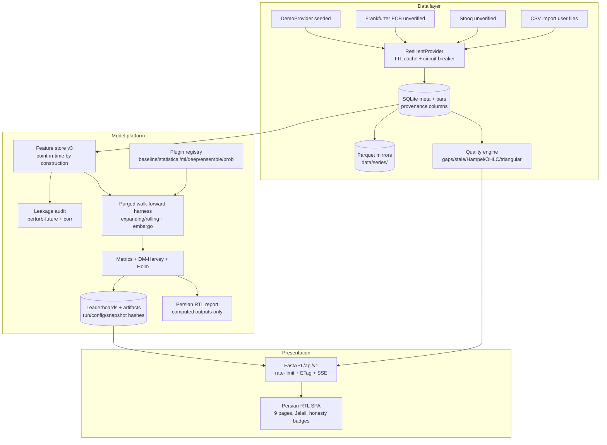

# AWAGO — FX Analysis & Forecasting Platform

AWAGO is a foreign-exchange (currency market) analysis and forecasting
platform with a **Persian-language, right-to-left (RTL) dashboard**. It runs
entirely on your own computer (Windows, macOS or Linux): clone, run one
command, open the browser.

> **Disclaimer:** For educational and analytical purposes only. This is not
> financial advice. No profit is promised or implied; forecasts are uncertain
> by nature and models may perform worse than trivial baselines (AWAGO reports
> this honestly when it happens).

---

## Features

- **Market data ingestion** through an abstract provider layer with
  de-duplicated persistent storage (SQLite by default, PostgreSQL optional).
- **10 currency pairs** out of the box (configurable): EUR/USD, GBP/USD,
  USD/JPY, USD/CHF, AUD/USD, USD/CAD, NZD/USD, EUR/GBP, EUR/JPY, USD/TRY.
- **Trend analysis**: direction, strength, slope, volatility regime.
- **Technical indicators**: log returns, SMA/EMA, RSI, MACD, Bollinger Bands,
  ATR, rolling volatility, lag and calendar features (all leak-free).
- **Multi-horizon forecasting** (1 / 7 / 30 days, configurable) with
  **prediction intervals** calibrated on walk-forward residuals.
- **Rigorous evaluation**: chronological walk-forward validation
  (expanding-window TimeSeriesSplit), never random splits. Every model is
  compared against a naive baseline ("tomorrow equals today") and a drift
  baseline, and the API/dashboard honestly state whether the model wins.
- **Persian RTL dashboard** with dark/light themes, interactive Chart.js
  charts (vendored locally — works offline), Vazirmatn font (vendored).
- **Demo mode**: reproducible synthetic data (fixed seed, GARCH-style
  volatility clustering) that is unmistakably labelled everywhere.
- **Documented REST API** with OpenAPI docs at `/docs`, one consistent error
  envelope, and job endpoints restricted to localhost (or token-protected).
- **Easy local execution**: one launcher script per OS.

## Prerequisites

- **Python 3.10 or newer** (the launcher checks and tells you if it's missing).
  Windows: install from [python.org](https://python.org) with *"Add python.exe
  to PATH"* checked. macOS/Linux: `python3 --version` should print 3.10+.
- No Node.js, no Docker, no database server, no internet needed for Demo mode.

## Quick start

### Windows

```bat
run.bat
```

### macOS / Linux

```bash
chmod +x run.sh   # first time only
./run.sh
```

### Any OS (manual)

```bash
python3 run.py
```

The launcher automatically:

1. verifies Python ≥ 3.10,
2. creates a virtual environment (`.venv`) and installs dependencies,
3. copies `.env.example` → `.env` (first run),
4. initializes the SQLite database under `data/`,
5. seeds price history when the database is empty (Demo or real per
   `DATA_MODE`),
6. trains lightweight models on first run (`AUTO_TRAIN_ON_SEED=true`) so the
   dashboard shows forecasts immediately,
7. starts the server at <http://127.0.0.1:8000> and opens your browser.

Useful flags: `python run.py --no-browser`, `--port 8001`, `--skip-seed`,
`--skip-train`, `--host 0.0.0.0` (see security warning in `.env.example`).

The dashboard is at <http://127.0.0.1:8000>, API docs at
<http://127.0.0.1:8000/docs>.

## Configuration (`.env`)

Copy `.env.example` to `.env` and edit. Every variable is optional.
Summary (full comments live in `.env.example`):

| Variable | Default | Meaning |
|----------|---------|---------|
| `HOST` | `127.0.0.1` | Bind address. `0.0.0.0` exposes to your LAN (see warning). |
| `PORT` | `8000` | HTTP port. |
| `OPEN_BROWSER` | `true` | Open the browser on launch. |
| `DATABASE_URL` | `sqlite:///data/awago.db` | Any SQLAlchemy URL (e.g. PostgreSQL). |
| `DATA_MODE` | `demo` | `demo` \| `live` \| `auto` — see next section. |
| `DATA_PROVIDER` | `frankfurter` | Real provider (`frankfurter` \| `demo`). |
| `FALLBACK_TO_DEMO` | `true` | Fall back to Demo data when the real source fails. |
| `FRANKFURTER_BASE_URL` | `https://api.frankfurter.dev/v1` | Frankfurter API base. |
| `HTTP_TIMEOUT_SECONDS` / `HTTP_RETRIES` | `15` / `3` | Outbound HTTP behaviour. |
| `DEFAULT_PAIRS` | 10 pairs | Comma-separated BASE/QUOTE list. |
| `HISTORY_DAYS` | `1095` | Days of history to keep/seed. |
| `DEMO_SEED` | `42` | Seed for reproducible demo data. |
| `FORECAST_HORIZONS` | `1,7,30` | Forecast horizons in days. |
| `PREDICTION_INTERVAL_LEVEL` | `0.90` | Prediction interval width. |
| `AUTO_TRAIN_ON_SEED` | `true` | Train quick models after first seeding. |
| `API_TOKEN` | *(unset)* | Optional token for job endpoints (see Security). |
| `LOG_LEVEL` | `INFO` | Logging verbosity (logs rotate in `data/logs/`). |

## Demo vs real data

- **Demo mode (`DATA_MODE=demo`)** — default. Deterministic synthetic prices
  (geometric random walk with GARCH-style volatility clustering, fixed seed).
  Same seed ⇒ same data on every machine. *Not real market data.*
- **Live mode (`DATA_MODE=live`)** — fetches real daily reference rates from
  the **Frankfurter API** (frankfurter.dev, ECB reference rates, free, no API
  key required).
- **Auto mode (`DATA_MODE=auto`)** — tries the real source first and falls
  back to Demo data if it fails (when `FALLBACK_TO_DEMO=true`).

Honesty rules enforced in code:

- Every API response carries `data_source` and `is_demo`; the dashboard shows
  a **prominent amber Demo banner** whenever demo data is on screen.
- The timestamp of the latest data point and the source name are always
  displayed. The app never claims "live" or "real-time" data.
- Demo and real bars are stored with a `data_source` flag and a uniqueness
  constraint on *(pair, timestamp, interval, data source)* — training and
  evaluation only ever use **one** source per pair (the pair's active
  source), so demo and real data can never mix.

### About the real data source (read this)

Frankfurter is a free, key-less API serving ECB daily **close-only**
reference rates on TARGET business days (no weekends). Bars are stored with
`open=high=low=close`; the ATR formula then degrades gracefully to a smoothed
close-to-close range.

> ⚠️ **Verification status:** the build environment for this project had **no
> outbound internet access** to `frankfurter.dev`, so the live endpoint could
> **not be verified here**. The provider is implemented from the published
> API documentation, but is presented as *unverified*. That is why the app
> defaults to Demo mode and falls back to Demo when a request fails. If you
> switch to `DATA_MODE=live` and hit problems, set `DATA_MODE=demo` and check
> the endpoint/URL in `.env`.

## Training models

Training never runs on plain server startup. Three ways to run it:

1. **Dashboard** — the "آموزش مدل‌ها" (Train models) button runs an async job.
2. **CLI**:
   ```bash
   python scripts/train_models.py                 # all pairs, all horizons
   python scripts/train_models.py --pairs EUR/USD --horizons 1,7
   python scripts/train_models.py --quick         # fast configuration
   python scripts/train_models.py --list          # show trained models
   ```
3. **API job**: `POST /api/v1/jobs/train` (localhost or token).

What training does:

- builds **leak-free features** (features at time *t* use only data ≤ *t*),
- evaluates Ridge, HistGradientBoosting, and LightGBM *(optional — skipped
  automatically if not installed)* with **expanding-window walk-forward**
  validation,
- compares each model against the **naive** ("price unchanged") and
  **drift** baselines on identical test rows,
- persists the winner per (pair, horizon) with `joblib` under
  `data/models/` together with metadata (training date, data range,
  features version, metrics, data source) and the walk-forward residual
  quantiles used for prediction intervals,
- stores per-model metrics in the database; `beats_baseline` is computed
  honestly and surfaced in the API and dashboard — including "does NOT beat
  baseline" verdicts.

To install the optional LightGBM candidate: `pip install lightgbm` (or add
the commented line in `requirements.txt`). Everything works without it.

## REST API (summary)

All endpoints are under `/api/v1`, typed with Pydantic, documented at
`/docs`. Errors always use one envelope:

```json
{"error": {"code": "pair_not_found", "message": "…", "details": null}}
```

| Method & path | Description |
|---------------|-------------|
| `GET /health` | Status, version, data mode, DB connectivity, latest data timestamp/source. |
| `GET /pairs` | Currency pairs with latest price + source flags. |
| `GET /pairs/{pair}/price` | Current price, change vs previous close, timestamp, source, `is_demo`. |
| `GET /pairs/{pair}/history` | `interval`, `start`, `end`, `limit` (chronological). |
| `GET /pairs/{pair}/forecast?horizon=` | Point forecast + prediction interval + model info. |
| `GET /pairs/{pair}/indicators` | RSI/MACD/SMA/ATR/volatility + trend analysis. |
| `GET /models`, `GET /models/{pair}` | Trained model metadata. |
| `GET /metrics/{pair}` | Walk-forward metrics vs baselines (`beats_baseline`). |
| `POST /jobs/collect-data`, `POST /jobs/train` | Async jobs (localhost or `X-API-Token`). |
| `GET /jobs/{id}` | Job status/progress/result. |

**Pair in URL:** the natural form works — `…/pairs/EUR/USD/price` — as well
as single-segment slugs (`EURUSD`, `EUR-USD`).

**Security:** job endpoints are only callable from localhost, or remotely
with a valid `X-API-Token` header matching `API_TOKEN` from `.env`. CORS is
closed by default. API keys/secrets live only in `.env` (gitignored).

## Running tests

```bash
.venv/bin/python -m pip install -r requirements-dev.txt
.venv/bin/python -m pytest tests/ -q
```

The suite covers indicator math, an explicit **no-leakage test** (perturbing
the future must not change features), chronological/walk-forward splitting,
metric calculations, Demo-provider determinism (including stability of past
values as time advances), API endpoints with a temporary database, error
envelopes, job access control, and Demo fallback behaviour.

## CLI scripts

```bash
python scripts/seed_demo.py      # seed deterministic demo history
python scripts/collect_data.py   # collect per DATA_MODE (demo/live/auto)
python scripts/train_models.py   # train + evaluate models
```

All support `--help`.

## Project structure

```
awago/
├── app/
│   ├── main.py                 # FastAPI app factory, error handlers, static
│   ├── config.py               # pydantic-settings (all config from env)
│   ├── logging_config.py       # rotating structured logs -> data/logs/
│   ├── db/                     # SQLAlchemy 2.x engine, session, models
│   ├── schemas/                # Pydantic request/response models
│   ├── api/                    # routers: health, pairs, forecast, models, jobs
│   ├── services/
│   │   ├── data_providers/     # base, demo, frankfurter, factory (+fallback)
│   │   ├── features/           # indicators + leak-free feature engineering
│   │   ├── forecasting/        # baselines, evaluation, training, persistence
│   │   ├── trend/              # trend analysis
│   │   └── market.py           # pair registry, collection, queries
│   ├── static/                 # css, js, vendored Chart.js + Vazirmatn, img
│   └── templates/index.html    # Persian RTL dashboard
├── scripts/                    # seed_demo, collect_data, train_models
├── tests/                      # pytest suite
├── data/                       # sqlite db, models, logs (gitignored)
├── run.py / run.sh / run.bat   # launchers
├── requirements.txt / requirements-dev.txt
└── .env.example / .gitignore / README.md
```

## Architecture decisions

- **FastAPI + SQLAlchemy 2.x (typed) + Pydantic v2** — modern, typed, one
  OpenAPI document generated automatically.
- **SQLite by default** — zero setup on the user's machine; `DATABASE_URL`
  can point at PostgreSQL without code changes. WAL mode enabled.
- **No frontend build step** — vanilla HTML/CSS/JS served by FastAPI;
  Chart.js 4.4.7 and the Vazirmatn font are **vendored** under
  `app/static/vendor/` so the dashboard works fully offline.
- **Direct multi-horizon models** (one regressor per horizon predicting the
  future log return) instead of recursive multi-step forecasting — simpler,
  no error compounding, per-horizon residual distributions for intervals.
- **Target = log return**, converted back to price — more stationary than raw
  prices; intervals are empirical quantiles of walk-forward residuals in
  return space (honest, model-agnostic calibration).
- **Walk-forward evaluation with expanding window** — the only legitimate
  evaluation for time series; scalers live inside sklearn pipelines and are
  fit on training folds only.
- **Feature-based regression over deep learning** — tabular lag/indicator
  features with gradient boosting is the pragmatic, well-evidenced choice for
  daily FX data at this scale; it runs in seconds on a laptop.
- **Optional LightGBM** — auto-detected, skipped gracefully; scikit-learn's
  HistGradientBoosting keeps everything runnable without compilers.
- **Pair symbols contain `/`**, which does not route in URL path segments, so
  pair-scoped endpoints accept both `EUR/USD` (two segments) and `EURUSD`
  (slug) forms and normalize internally.
- **Image assets**: the 10 curated images could not be generated in the build
  environment (service unavailable). Lightweight SVG placeholders ship in
  `app/static/img/`; `docs/IMAGE_PROMPTS.md` holds all prompts and the
  drop-in procedure. Generated files are picked up automatically.

## Troubleshooting

| Problem | Fix |
|---------|-----|
| *"Python 3.10+ is required"* | Install Python from [python.org](https://python.org); on Windows check "Add to PATH". |
| *"Port 8000 … already in use"* | Stop the other program, or `python run.py --port 8001`, or edit `PORT` in `.env`. |
| Dependency install fails | Check your internet connection for the first install; retry with `.venv/bin/python -m pip install -r requirements.txt`. |
| `python3-venv` missing (Debian/Ubuntu) | `sudo apt install python3-venv`. |
| Dashboard shows the Demo banner | Expected with `DATA_MODE=demo`. Switch to `live`/`auto` for real data. |
| Forecast says "no trained model" | Run `python scripts/train_models.py` or the dashboard's train button. |
| Live data returns an error | The Frankfurter endpoint is unverified in the build env (see above). Check `FRANKFURTER_BASE_URL`, your network, or set `DATA_MODE=demo`. |
| Everything looks broken after a config change | Delete `data/awago.db*` and re-run the launcher to reseed. |

## Known limitations

- Only daily (`1d`) bars are supported; intraday intervals are rejected with
  a clear error.
- The real provider returns close-only prices (OHLC equal to close).
- The forecast target date is approximate (calendar-day offset; the future
  trading calendar is unknown).
- The Frankfurter live endpoint was **not verifiable** from the build
  environment (see "About the real data source").
- Jalali dates are computed client-side for display; chart axes use ISO
  Gregorian dates for precision.
- One job worker pool (2 threads) in-process — fine for personal use, not a
  multi-user deployment (by design: local tool).
- The 10 curated images ship as SVG placeholders (see `docs/IMAGE_PROMPTS.md`).

## Financial disclaimer

For educational and analytical purposes only. This is not financial advice.
AWAGO does not promise profit, does not issue buy/sell instructions, and its
forecasts — including prediction intervals — can be wrong. Past back-test
performance (walk-forward or otherwise) does not guarantee future results.
Use at your own risk.

---

# AWAGO v2 — research-grade evolution

v2 turns AWAGO into a probabilistic forecasting **research platform** with
statistical honesty guarantees. Everything below describes what is actually
implemented and measured in this repository (see `docs/PROGRESS.md` for the
per-phase status table).

## Architecture



## Data sources

| Provider | Type | Key | Verified live in build env | Notes |
|---|---|---|---|---|
| `demo` | seeded synthetic | no | yes | Default. Deterministic, always labeled. |
| `frankfurter` | ECB reference rates | no | **no** | Unverified — sandbox cannot reach it. Confirm via `/api/v1/providers`. |
| `stooq` | daily CSV endpoint | no | **no** | Unverified. Respect rate limits; check stooq.com terms. |
| `csv_import` | local files in `data/imports/` | no | yes | **The sanctioned path for IRR / any rate without a legitimate API.** |

Evaluated but NOT implemented (reasons in `docs/DATA_SOURCES.md`): FRED,
Alpha Vantage, Twelve Data (API keys, unverifiable here), Yahoo (no official
API), any scraping (rejected). Demo/real separation is enforced at schema
level (`CHECK (is_demo = (data_source = 'demo'))`).

## Model catalog

| Family | Models | Notes |
|---|---|---|
| Baselines | naive, drift, seasonal-naive(7d), MA(20), Holt ETS | The yardstick every model is judged against. |
| Statistical | ARIMA(1,1,1) (bounded refit cadence), GARCH(1,1) vol (optional `arch`) | GARCH forecasts σ only (direction = 0 by design). |
| Classical ML | Ridge, ElasticNet, RandomForest, ExtraTrees, HistGB (direct), Ridge-recursive | Direct multi-horizon (one model per horizon). |
| Deep (lite) | MLP (sklearn, no torch) | Torch LSTM/N-BEATS/TFT documented as skipped. |
| Ensembles | average, inverse-error, stacking, online-decayed | Weights/meta fit on earlier OOF folds only; fall back to baseline on failure. |
| Probabilistic | QuantileGBM, split conformal, CQR, adaptive conformal | Always reports empirical vs nominal coverage. |

## Evaluation methodology

* Targets: future log returns; features strictly point-in-time (leakage
  harness with negative tests).
* Walk-forward only (expanding/rolling), **purged** (horizon−1) + embargo.
* Metrics: MAE, RMSE, MASE, sMAPE, directional accuracy, pinball, CRPS,
  coverage, interval width, Winkler.
* Significance: Diebold-Mariano (Harvey-Leybourne-Newbold correction) vs the
  naive baseline on identical rows, Holm-Bonferroni across the family.
* Verdicts are one of: `beats baseline significantly` / `beats baseline, not
  significantly` / `worse than baseline (significant)` / `not better than
  baseline`.
* Holdout (tail 20%) is evaluated **once per family** ("held out, evaluated
  once").
* Backtests are **simulations**: sign positions, 1x notional, no leverage,
  mandatory costs + slippage, buy-and-hold AND seeded random-signal controls,
  deflated-Sharpe caution, and the disclaimer on every screen.

## v2 API additions (v1 contract kept)

`/api/v1/features` · `/api/v1/quality/{pair}` · `/api/v1/providers` ·
`/api/v1/experiments/run(s)` · `/api/v1/leaderboards/*` ·
`/api/v1/registry/{models,artifacts,compare,promote,rollback}` ·
`/api/v1/regimes/{pair}` · `/api/v1/volatility/{pair}` ·
`/api/v1/forecasts/probabilistic/{pair}` (fan chart + empirical coverage) ·
`/api/v1/backtests/{pair}` · `/api/v1/explainability/{pair}` ·
`/api/v1/drift/{pair}` · `/api/v1/reports/{run_id}` ·
`/api/v1/pairs/{pair}/export?format=csv|parquet` ·
`/api/v1/jobs/{id}/events` (SSE) · `/api/v1/jobs/{id}/cancel`

## v2 run commands

Same one-command launchers as v1:

```bash
./run.sh                 # lite profile (default): few-minute first run
./run.sh --profile full  # all pairs, more folds/models
python run.py --help     # every flag documented
python -m app.cli config show        # redacted configuration
python -m app.cli report --run latest --out report.html   # Persian report
make lint && make test   # quality gates
```

Environment facts (honesty): the build sandbox cannot reach market-data
hosts, GitHub Actions could not be executed here, and the Windows launcher
(`run.bat`) is untested in this environment. Every real provider ships
labeled "unverified" until you confirm it on your network.
